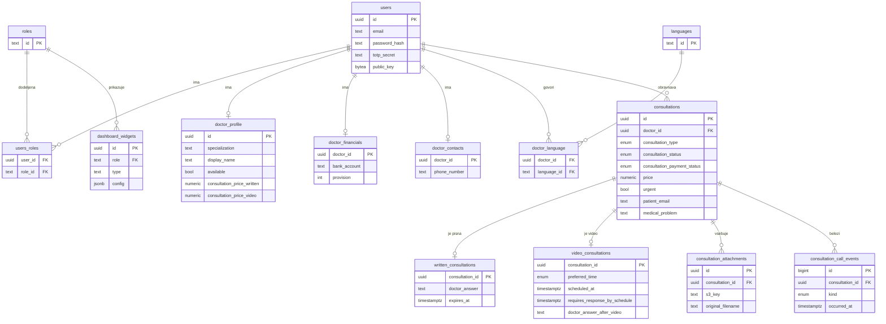

# Podatkovni model

Podatki so shranjeni v relacijski bazi **PostgreSQL**. Priloge (izvidi) so shranjene v objektni shrambi (S3/MinIO), v bazi so le njihovi metapodatki. Vse tabele imajo še polji `created_at` in `updated_at`, ki ju spodaj ne navajamo.

## Entitete in glavna polja

| Entiteta | Namen | Glavna polja |
|---|---|---|
| **users** | Prijavljeni uporabniki (zdravniki, administratorji) | `id`, `email`, `password_hash`, `name`, `totp_secret`, `totp_enrolled`, `public_key`, `encrypted_private_key` |
| **roles** | Vloge v sistemu (`admin`, `doctor`) | `id` |
| **users_roles** | Dodelitev vlog uporabnikom | `user_id`, `role_id` |
| **doctor_profile** | Javni profil zdravnika | `id` (= `users.id`), `specialization`, `subspecialization`, `display_name`, `bio`, `workplace`, `available`, `consultation_price_written`, `consultation_price_video` |
| **doctor_financials** | Finančni podatki zdravnika | `doctor_id`, `bank_account`, `provision`, `provision_change_reason` |
| **doctor_contacts** | Kontaktni podatki zdravnika | `doctor_id`, `phone_number`, `meeting_link` |
| **languages** / **doctor_language** | Jeziki, ki jih zdravnik govori | `id` / `doctor_id`, `language_id` |
| **consultations** | Skupni podatki vsake konzultacije | `id`, `doctor_id`, `consultation_type` (`written`/`video`), `consultation_status` (`scheduled`/`pending`/`finished`/`not_attended`), `consultation_payment_status`, `price`, `urgent`, `need_translator`, podatki pacienta (`patient_name`, `patient_surname`, `patient_age`, `patient_email`, `patient_phone`), `medical_problem`, `patient_diagnosis`, `allergies`, `medication`, `signature_doctor_url`, `finished_at` |
| **written_consultations** | Podrobnosti pisne konzultacije | `consultation_id`, `doctor_answer`, `expires_at` (+72 h), `email_reminder_sent` |
| **video_consultations** | Podrobnosti video konzultacije | `consultation_id`, `preferred_time` (`morning`/`afternoon`/`evening`), `scheduled_at`, `requires_response_by_schedule` (+12 h, nujno +8 h), `expires_at_after_video` (+24 h), `doctor_answer_after_video` |
| **consultation_attachments** | Priloge pacienta | `id`, `consultation_id`, `s3_key`, `original_filename`, `content_type`, `size_bytes` |
| **consultation_call_events** | Dnevnik dogodkov video klica | `id`, `consultation_id`, `kind` (npr. `patient_joined`, `ice_failed`, `call_ended`), `occurred_at`, `detail` |
| **dashboard_widgets** | Gradniki nadzorne plošče za posamezno vlogo | `id`, `role`, `title`, `type`, `config`, `layout` |
| **sessions** | Seje prijavljenih uporabnikov | `token`, `data`, `expiry` |

Pacient nima uporabniškega računa, zato so njegovi podatki shranjeni neposredno v `consultations`.

## Povezave med entitetami

- **users - roles**: M:N prek `users_roles`.
- **users - doctor_profile / doctor_financials / doctor_contacts**: 1:1 (le za zdravnike).
- **users - languages**: M:N prek `doctor_language`.
- **users (zdravnik) - consultations**: 1:N - zdravnik ima več konzultacij, vsaka konzultacija pripada enemu zdravniku.
- **consultations - written_consultations / video_consultations**: 1:1 - glede na `consultation_type` ima konzultacija natanko eno od obeh razširitev.
- **consultations - consultation_attachments**: 1:N.
- **consultations - consultation_call_events**: 1:N (le za video konzultacije).
- **roles - dashboard_widgets**: 1:N.

Roke (`expires_at`, `requires_response_by_schedule`, `expires_at_after_video`) samodejno izračunajo prožilci (triggerji) v bazi.

## Osnutek podatkovnega modela

