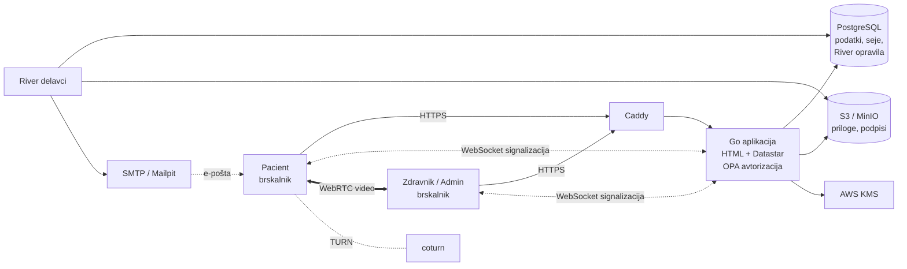

# Arhitektura in tehnološki sklad

## Arhitektura

### Glavni deli sistema

- **Spletna aplikacija (Go)** - en strežniški proces, ki strežniško izrisuje HTML strani, obdeluje obrazce in avtorizacijo ter usmerja video klice.
- **Video modul** - posrednik signalizacije (WebSocket) med zdravnikom in pacientom; sam video teče neposredno med brskalnikoma (WebRTC), po potrebi prek TURN strežnika.
- **Delavci v ozadju (River)** - opomniki po e-pošti, podpisovanje mnenj, označevanje neopravljenih konzultacij, obvestila o spremembi provizije.
- **PostgreSQL** - vsi podatki aplikacije, seje in čakalna vrsta opravil.
- **Objektna shramba (S3 / MinIO)** - priloge pacientov in podpisi mnenj.
- **AWS KMS** - šifriranje zasebnih ključev zdravnikov za digitalni podpis.
- **SMTP strežnik** - pošiljanje e-pošte (lokalno Mailpit).
- **Caddy** - povratni posrednik (reverse proxy) s HTTPS in omejevanjem števila zahtev.

### Komunikacija med deli

- Brskalnik ↔ Caddy ↔ aplikacija: **HTTPS**. Strani se izrisujejo na strežniku, delne posodobitve strani prek **Datastar** (strežniški dogodki, SSE).
- Video: brskalnika izmenjata SDP/ICE sporočila prek **WebSocket** povezave na aplikacijo, nato se povežeta neposredno prek **WebRTC** (STUN/TURN za prehod NAT).
- Aplikacija → delavci: opravila se vpišejo v tabelo River v isti bazi, **v isti transakciji** kot sprememba podatkov (River je embedded in upošteva PostgreSQL transakcije).
- Aplikacija → S3 / KMS: **AWS SDK** (HTTPS). Aplikacija → e-pošta: **SMTP**.

### Podatkovna baza

Relacijska baza **PostgreSQL 18** (podrobno v [03-podatkovni-model.md](03-podatkovni-model.md)). Shema se upravlja z migracijami, ki se ob zagonu izvedejo samodejno. Roke konzultacij izračunajo prožilci v bazi.

### Avtentikacija in upravljanje uporabnikov

- Prijavljajo se samo **zdravniki in administratorji**: e-pošta + geslo (bcrypt) + **obvezna dvostopenjska prijava (TOTP)**.
- Seje so shranjene v bazi (piškotek + tabela `sessions`).
- **Avtorizacija** s pravili v jeziku Rego (**Open Policy Agent**): vsak zahtevek se preveri glede na vlogo in lastništvo (npr. zdravnik vidi le svoje konzultacije).
- Zdravnike ustvari administrator; zdravnik prejme dostopne podatke po e-pošti.
- **Pacient** nima računa - v video klic vstopi s **podpisanim, časovno omejenim žetonom (HMAC)** v povezavi iz e-pošte.

### Lokalni zagon

Orodja in opravila upravlja **mise** (`mise.toml` v korenu projekta). Edini predpogoja sta mise in Docker.

```bash
mise install
```

```bash
mise run develop
```

- `mise install` namesti točne različice orodij (Go, templ, golangci-lint, Hurl, Caddy), zapisane v `mise.toml`.
- `mise run develop` z enim ukazom zažene celotno razvojno okolje. Opravilo združuje manjša opravila, ki jih mise izvaja vzporedno:

| Opravilo      | Kaj zažene                                                                                       |
| ------------- | ------------------------------------------------------------------------------------------------ |
| `docker:up`   | PostgreSQL, MinIO in Mailpit (Docker Compose) - izvede se najprej, ostala opravila počakajo nanj |
| `templ:watch` | sprotno generiranje Go kode iz predlog `.templ`                                                  |
| `api:run`     | aplikacijo na `http://localhost:8080` (migracije se izvedejo samodejno)                          |
| `caddy:run`   | HTTPS na `https://cybermedico.local`                                                             |

Poslana e-pošta je vidna v Mailpit na `http://localhost:8025`. Vsako opravilo je mogoče zagnati tudi posebej (npr. `mise run api:run`), teste HTTP pa z `mise run test:hurl`. Vsa opravila izpiše `mise tasks`.

### Diagram



## Tehnološki sklad

| Področje                          | Tehnologije                                                                                                                                                                                                                 |
| --------------------------------- | --------------------------------------------------------------------------------------------------------------------------------------------------------------------------------------------------------------------------- |
| **Frontend**                      | Strežniško izrisan HTML s **templ**, **Datastar** (interaktivnost prek SSE), **Pico CSS**, Quill (urejevalnik odgovorov), Gridstack + ECharts (nadzorna plošča), Toastify (obvestila), WebRTC (video klic, `video-call.js`) |
| **Backend**                       | **Go 1.27**, standardni `net/http`, **ogen** (generiranje strežnika iz OpenAPI specifikacije), **River** (čakalna vrsta opravil) + River UI                                                                                 |
| **Podatkovna baza**               | **PostgreSQL 18**, pgx (gonilnik), golang-migrate (migracije)                                                                                                                                                               |
| **Avtentikacija in avtorizacija** | bcrypt (gesla), pquerna/otp (TOTP), scs + pgxstore (seje), **Open Policy Agent** (Rego pravila), HMAC žetoni (vstop pacienta v video klic)                                                                                  |
| **Lokalni razvoj**                | **mise** (različice orodij in opravila), Docker Compose (PostgreSQL, MinIO, Mailpit), templ watch, golangci-lint, Hurl (HTTP testi), Caddy                                                                                  |
| **Drugo**                         | S3 / MinIO (datoteke), AWS KMS + Ed25519 (digitalni podpis mnenj), coturn (TURN), SMTP (e-pošta), coder/websocket (signalizacija)                                                                                           |

## Arhitekturne odločitve

- **Monolit v Go namesto mikrostoritev** - majhna ekipa in en sam proces za razvoj, zagon in razhroščevanje; Go je hiter in se prevede v eno izvršljivo datoteko.
- **Strežniško izrisovanje (templ + Datastar) namesto SPA** - brez ločenega frontend projekta in gradnje JavaScripta; logika ostane na strežniku, interaktivnost je kljub temu mogoča prek SSE.
- **OpenAPI + ogen** - API je opisan v eni specifikaciji, iz katere se generirajo tipi in usmerjanje, zato se koda in specifikacija ne razhajata.
- **PostgreSQL** - podatki so izrazito relacijski (zdravnik - konzultacija - priloge), potrebne so transakcije; ista baza služi tudi za seje in čakalno vrsto.
- **River v PostgreSQL namesto ločenega posrednika sporočil** - opravilo se vpiše v isti transakciji kot podatki, zato ni izgubljenih opomnikov; ni dodatne infrastrukture (Redis, RabbitMQ).
- **OPA za avtorizacijo** - pravila dostopa so na enem mestu, ločena od kode in berljiva (npr. "zdravnik odgovori le na svojo pisno konzultacijo v statusu `pending`").
- **Obvezna TOTP prijava** - zdravniki in administratorji dostopajo do zdravstvenih podatkov, zato samo geslo ni dovolj.
- **Pacient brez računa, vstop z žetonom** - manj trenja za enkratnega uporabnika; žeton velja samo za eno konzultacijo in samo v času termina.
- **WebRTC peer-to-peer** - video ne teče prek našega strežnika (manjša obremenitev, boljša zasebnost); TURN le kot rezerva, ko neposredna povezava ni mogoča.
- **Digitalni podpis z Ed25519 in KMS** - podpis dokazuje, da mnenja po oddaji nihče ni spremenil; zasebni ključ zdravnika je šifriran s ključem v KMS in ni nikoli shranjen v čistopisu.
- **mise namesto Make in ročne namestitve orodij** - en `mise.toml` določa različice orodij in opravila, zato ima vsak razvijalec enako okolje z enim ukazom (`mise install`). Opravilo `develop` poveže vse procese (baza, Mailpit, Caddy, aplikacija, templ) v en ukaz namesto več terminalov; opravila delujejo enako na Windows, Linux in macOS.
- **S3-združljiva shramba** - datoteke niso v bazi; lokalno MinIO, v produkciji katerikoli S3 ponudnik brez spremembe kode.
