# Wireframes

## Administrator

### 1. Prijava in dvostopenjsko preverjanje

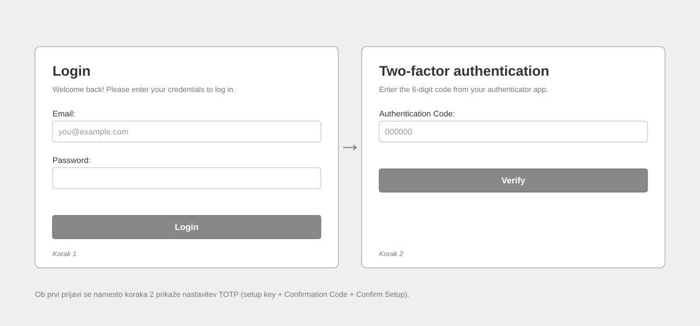

Prijava z e-pošto in geslom (korak 1), nato vnos 6-mestne kode iz aplikacije za preverjanje pristnosti (korak 2). Ob prvi prijavi se namesto koraka 2 prikaže nastavitev TOTP. Enako za administratorja in zdravnika. - US-15

### 2. Nadzorna plošča

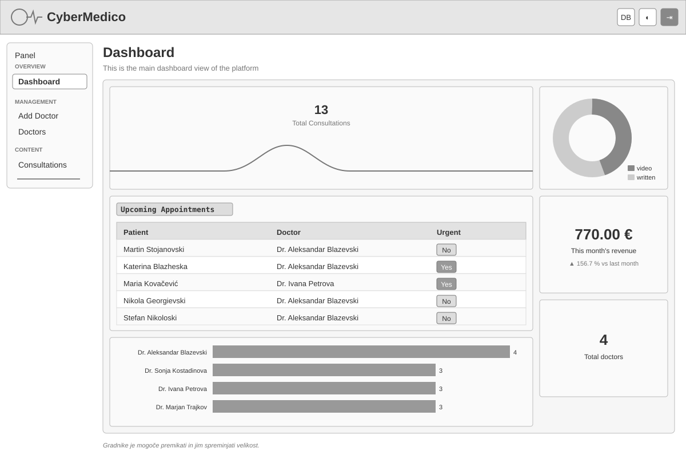

Gradniki s statistiko: skupno število konzultacij skozi čas, razmerje video / pisnih, prihajajoči termini z oznako nujnosti, prihodek tekočega meseca v primerjavi s prejšnjim, število konzultacij po zdravniku in skupno število zdravnikov. Gradnike je mogoče premikati. - US-14

### 3. Seznam konzultacij

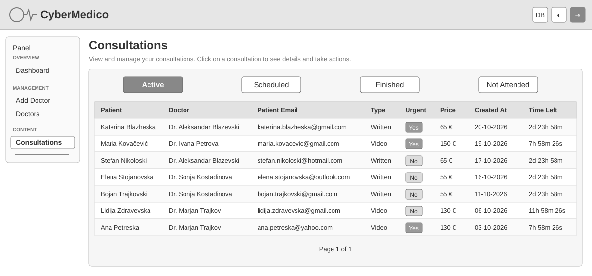

Zavihki po statusu (Active, Scheduled, Finished, Not Attended - slednji le za administratorja) in tabela s pacientom, zdravnikom, e-pošto, vrsto, nujnostjo, ceno, datumom in preostalim časom do roka. Klik na vrstico odpre podrobnosti. - US-11

### 4. Podrobnosti konzultacije

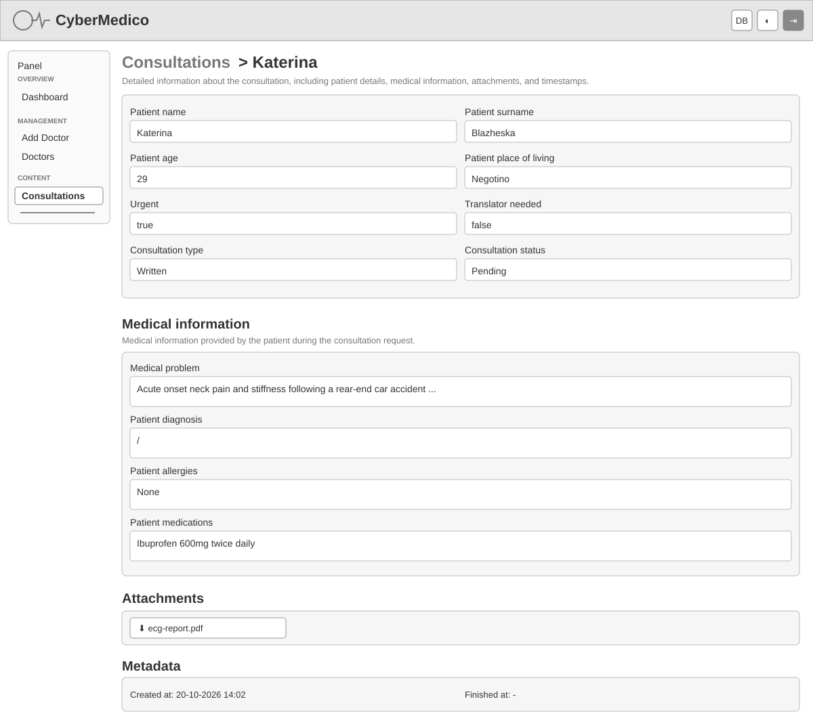

Podatki pacienta in stanje konzultacije, zdravstveni podatki (težava, diagnoza, alergije, zdravila), priloge za prenos in časovni žigi. Administrator konzultacijo le pregleduje, odgovarjati ne more. - US-02, US-09

### 5. Seznam zdravnikov

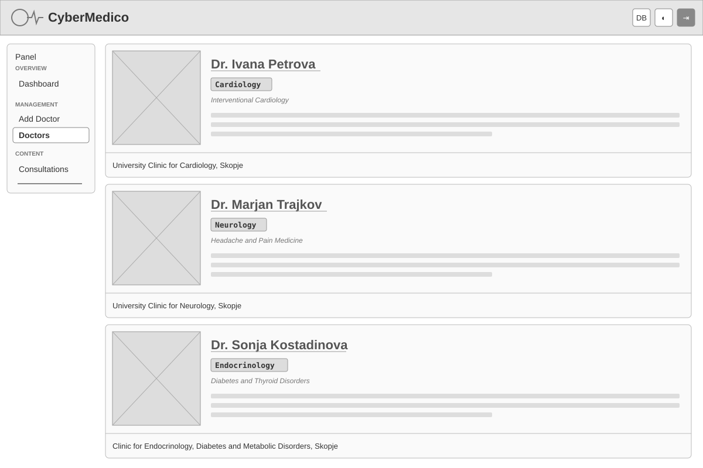

Kartica vsakega zdravnika s fotografijo, imenom, specializacijo, podspecializacijo, predstavitvijo in delovnim mestom. Klik na ime odpre profil. - US-12

### 6. Profil zdravnika in sprememba provizije

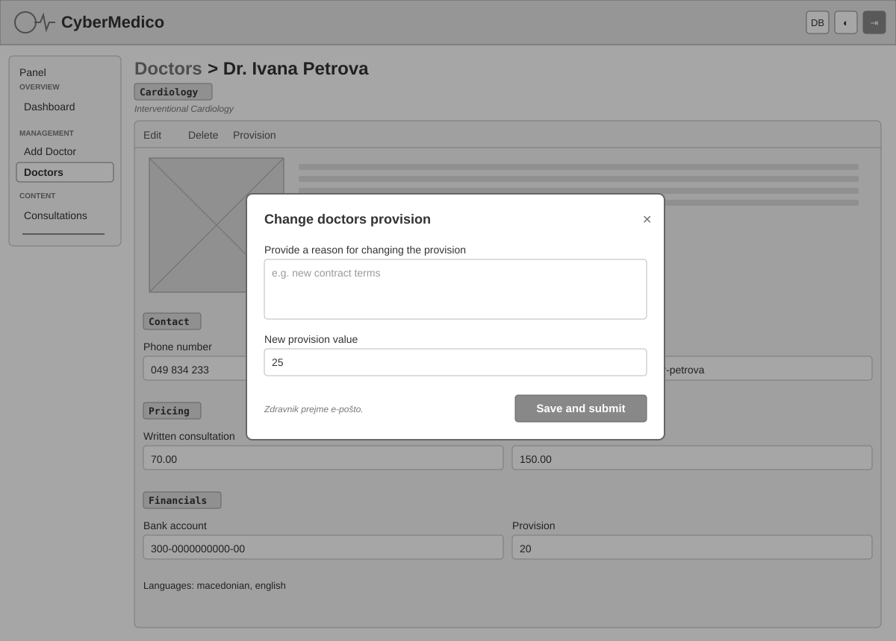

Profil z dejanji Edit, Delete in Provision ter razdelki Contact, Pricing, Financials in jeziki. Prikazano je modalno okno **Change doctors provision** z obvezno obrazložitvijo in novo vrednostjo; po shranjevanju zdravnik prejme e-pošto. - US-13

### 7. Dodajanje zdravnika

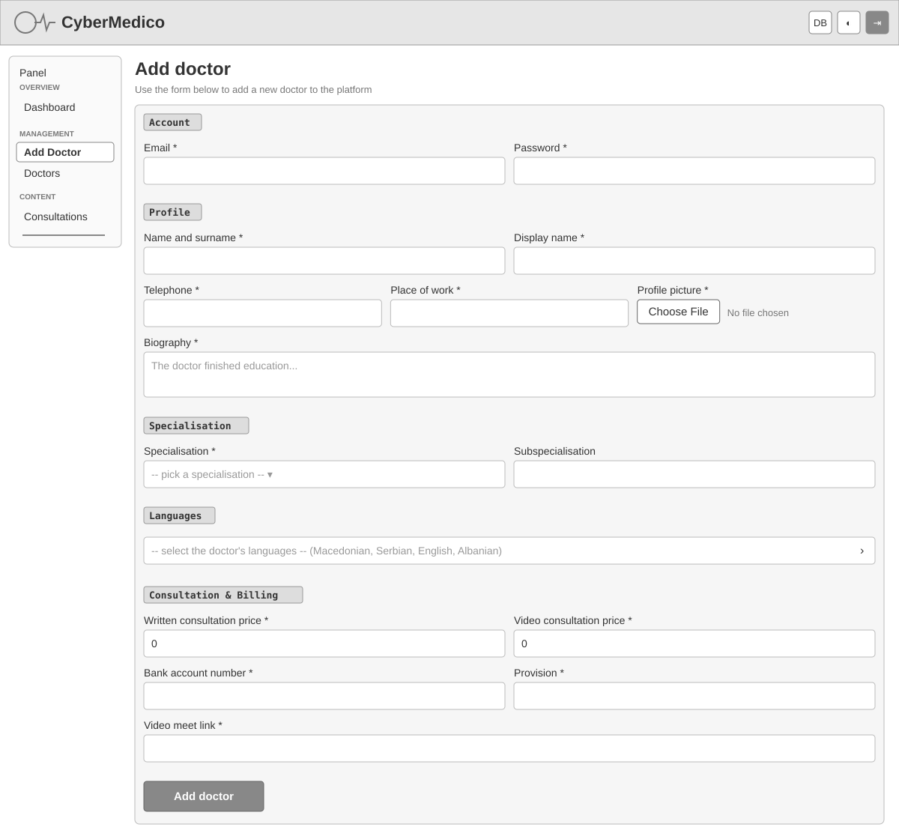

Obrazec v razdelkih Account, Profile, Specialisation, Languages in Consultation & Billing (cene, bančni račun, provizija, povezava za video sestanek). Obvezna polja so označena z `*`. - US-12

## Zdravnik

Zdravnik ima ožji meni (le Dashboard in Consultations), na seznamu konzultacij vidi samo svoje konzultacije in nima zavihka Not Attended. Podrobnosti konzultacije so enake kot pri administratorju (zaslon 4), le da je pod levim menijem gumb za dejanje glede na stanje: **Schedule**, **Write answer** ali vstop v video klic.

### 8. Nadzorna plošča zdravnika

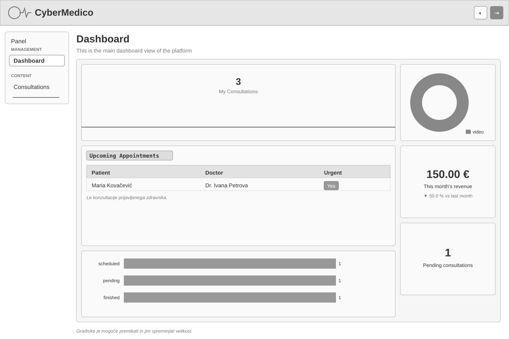

Enaki gradniki kot pri administratorju, a samo s podatki prijavljenega zdravnika: njegove konzultacije, prihajajoči termini, prihodek v mesecu, število čakajočih konzultacij in konzultacije po statusu. - US-14

### 9. Določitev termina video klica

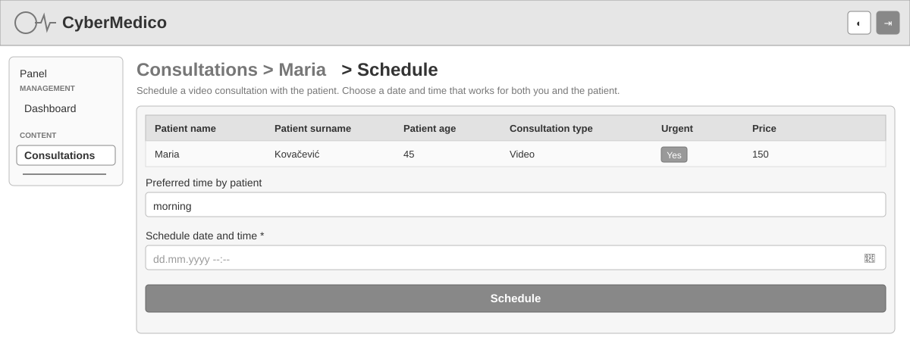

Povzetek konzultacije, pacientov želeni del dneva in izbira datuma in ure klica. Po potrditvi pacient prejme e-pošto s terminom in povezavo. - US-05, US-06

### 10. Pisni odgovor s potrditvijo TOTP

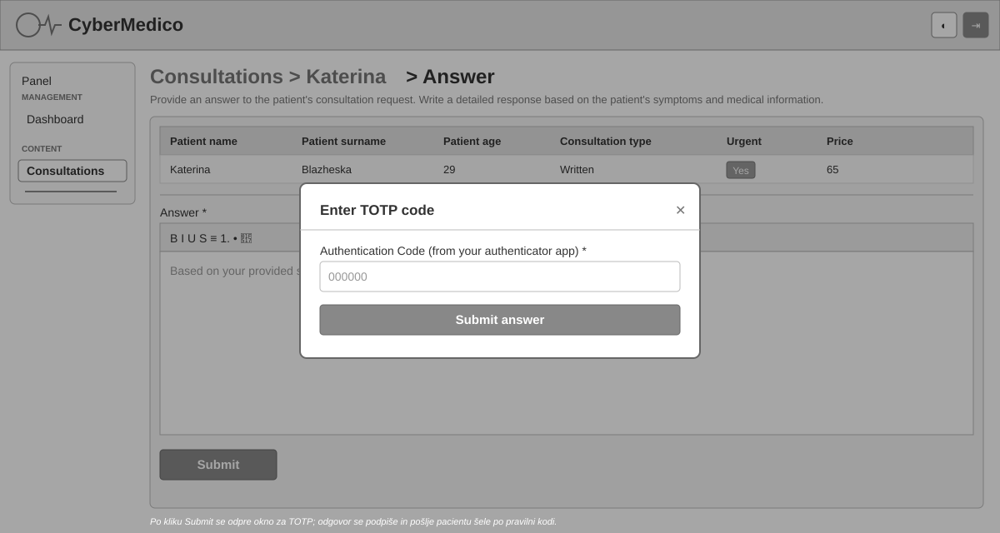

Povzetek konzultacije in urejevalnik besedila za odgovor. Po kliku **Submit** se odpre okno **Enter TOTP code**; odgovor se digitalno podpiše in pošlje pacientu po e-pošti šele po vnosu pravilne kode. Ponovna potrditev je varnostni ukrep: podpis v imenu zdravnika ne sme biti mogoč samo z odprto sejo. - US-04, US-09, US-15

### 11. Video klic

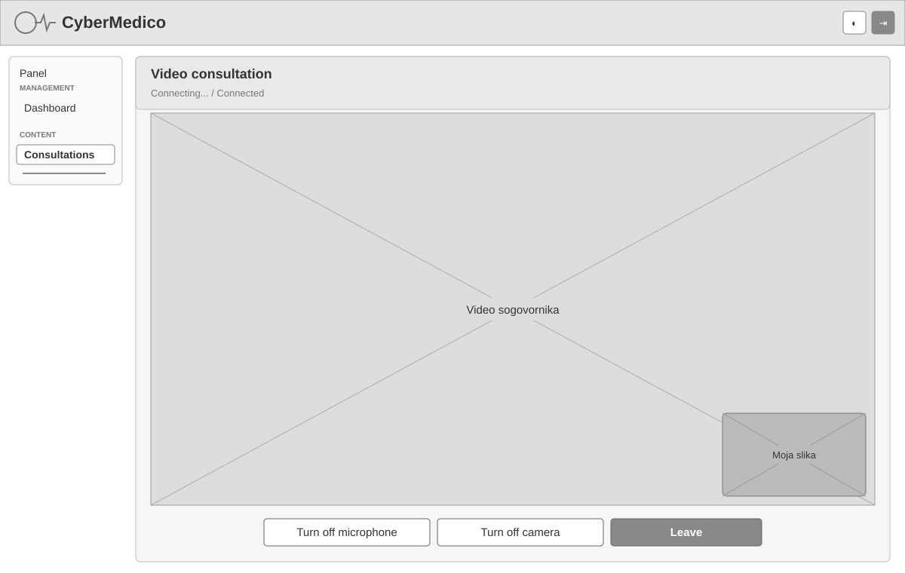

Stanje povezave, slika sogovornika čez celo površino, manjši predogled lastne kamere in gumbi Turn off microphone, Turn off camera in Leave. Če uporabnik zavrne dostop do kamere in mikrofona, se pod naslovom izpiše opozorilo z navodilom za ponovni poskus. Pacient vidi enak zaslon brez levega menija (vstop prek povezave iz e-pošte). - US-07, US-08

### Seznam zdravnikov za paciente

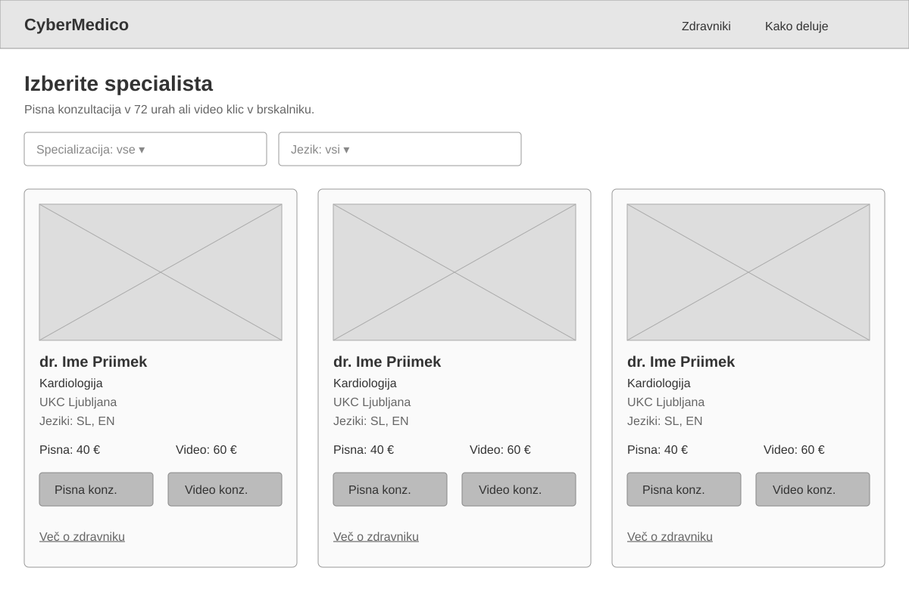

Javna stran za izbiro specialista s filtri po specializaciji in jeziku ter cenama pisne in video konzultacije. - US-01

### Obrazec za konzultacijo

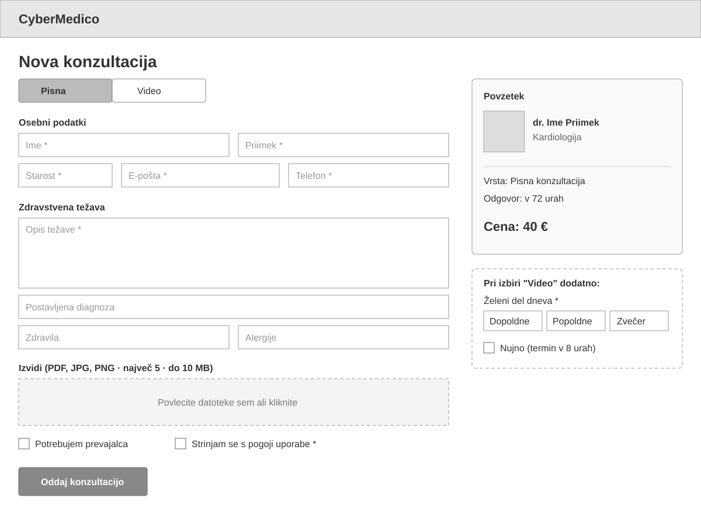

Izbira vrste (pisna / video), osebni in zdravstveni podatki, nalaganje izvidov, prevajalec in pogoji uporabe; pri video konzultaciji še želeni del dneva in nujnost. - US-02, US-03
